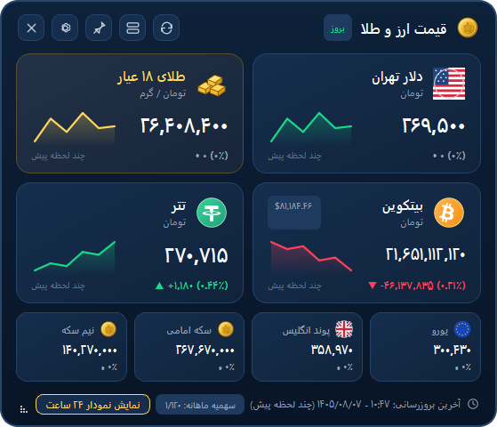
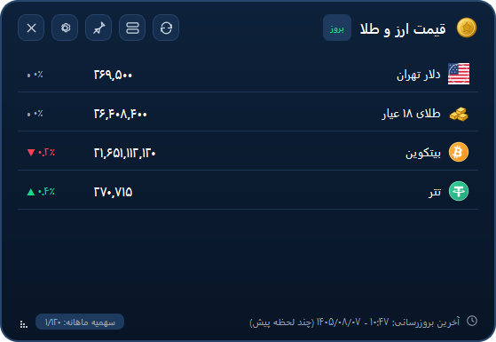

# Chande (چنده) — Windows Desktop Currency, Gold & Crypto Gadget

<p align="center">
  <strong>ویجت دسکتاپ ویندوز برای نمایش لحظه‌ای قیمت دلار، طلای ۱۸ عیار، بیت‌کوین و تتر</strong><br>
  <span>A lightweight, native Windows 10/11 desktop gadget for tracking live Iranian currency, gold, and cryptocurrency rates with strict API quota protection, bilingual UI (Persian/English), and automatic GitHub updates.</span>
</p>

<p align="center">
  <a href="#-quick-start-for-windows-users-install-without-python">Quick Start (Windows)</a> •
  <a href="#-راهنمای-سریع-نصب-برای-کاربران-ویندوز-بدون-نیاز-به-پایتون">راهنمای نصب سریع (فارسی)</a> •
  <a href="#-screenshots--تصاویر-برنامه">Screenshots</a> •
  <a href="#-key-features--ویژگیهای-اصلی">Features</a> •
  <a href="#-automatic-update-system--سیستم-بهروزرسانی-خودکار">Auto-Updater</a> •
  <a href="docs/">Documentation (docs/)</a>
</p>

---

## 📸 Screenshots / تصاویر برنامه

| Expanded Mode (حالت کامل با نمودار) | Compact Mode (حالت فشرده ۲×۲) |
| :---: | :---: |
|  |  |

---

## 🚀 Quick Start for Windows Users (Install Without Python)

Most users **do not need Python or programming tools**. You can run Chande directly from the portable Windows release package:

1. **Download the Release ZIP:**
   Go to the repository's **Releases** page and download the latest **`Chande-v1.2.0-Windows-x64.zip`**.
2. **Extract the Folder:**
   Right-click the downloaded `.zip` file, click **Extract All...**, and extract it to a permanent folder (for example, `C:\Users\<YourName>\Apps\Chande`).
3. **Run Chande:**
   Open the extracted folder and double-click **`Chande.exe`**.
   *(If Windows SmartScreen appears, click **More info** -> **Run anyway**.)*
4. **Enter Your Navasan API Key:**
   - Click the **Gear icon (`⚙`)** on the widget header (or right-click the **Chande** icon in the Windows system tray and choose **Settings / تنظیمات**).
   - Paste your Navasan API key into the **Navasan API Key** field and click **Save Changes**.
   - Click the **Refresh (`↻`)** button once to fetch your initial market prices.

> 📖 **Detailed Guides:** See [docs/INSTALLATION.md](docs/INSTALLATION.md) for step-by-step setup and [docs/CONFIGURATION.md](docs/CONFIGURATION.md) for all settings.

---

## 🇮🇷 راهنمای سریع نصب برای کاربران ویندوز (بدون نیاز به پایتون)

برای استفاده از **چنده (Chande)** نیازی به نصب پایتون یا ابزارهای برنامه‌نویسی ندارید:

۱. **دانلود نسخه آماده ویندوز:**
   به بخش **Releases** در مخزن گیت‌هاب بروید و آخرین فایل **`Chande-v1.2.0-Windows-x64.zip`** را دانلود کنید.
۲. **استخراج فایل فشرده (Extract):**
   روی فایل ZIP راست‌کلیک کرده و گزینه **Extract All...** را بزنید تا محتویات آن در یک پوشه دائمی (مثلاً روی دسکتاپ یا پوشه برنامه‌هایتان) استخراج شود.
۳. **اجرای برنامه:**
   وارد پوشه استخراج‌شده شوید و فایل **`Chande.exe`** را اجرا کنید.
   *(اگر پنجره محافظ ویندوز SmartScreen نمایش داده شد، روی **More info** و سپس **Run anyway** کلیک کنید.)*
۴. **وارد کردن کلید API نوسان:**
   - روی دکمه **تنظیمات (`⚙`)** در بالای ویجت کلیک کنید (یا روی آیکون **چنده** در سینی سیستم کنار ساعت ویندوز راست‌کلیک کرده و **تنظیمات** را انتخاب نمایید).
   - کلید API دریافتی از وب‌سایت [Navasan.tech](http://navasan.tech) را در بخش **کلید API نوسان** وارد کرده و **ذخیره تغییرات** را بزنید.
   - یک بار دکمه **بروزرسانی (`↻`)** را بزنید تا قیمت‌های اولیه دریافت و ذخیره شوند.

---

## ✨ Key Features / ویژگی‌های اصلی

### 1. Live Four-Instrument Market Tracking (نمایش ۴ شاخص اصلی بازار)
- **US Dollar (`usd_sell`) / دلار آمریکا (فروش):** Live free-market sell rate + 24h change & percentage.
- **18K Gold (`18ayar`) / طلای ۱۸ عیار:** Live per-gram rate + 24h change & percentage.
- **Bitcoin (`btc`) / بیت‌کوین:** Live price + 24h change & percentage.
- **Tether (`usdt`) / تتر:** Live rate + 24h change & percentage.
- Optional secondary cards (`sekee`, `eur`, `gbp`, `aed`) toggled anytime in Settings.

### 2. Classic Windows 7 Desktop Gadget Behavior (رفتار مشابه گجت‌های ویندوز ۷)
- **Always Visible, Never Intrusive:** Remains visible above normal and maximized desktop applications without stealing keyboard focus (`WS_EX_TOOLWINDOW | WS_EX_NOACTIVATE`).
- **Excluded from Alt+Tab & Taskbar:** Keeps your taskbar and `Alt+Tab` switcher completely clean.
- **Exact Position & Size Memory:** Drag from any empty area to position on any monitor; Chande remembers and restores your exact coordinates (`window_x`, `window_y`) and dimensions across restarts.
- **Multi-Monitor & Resolution Safe:** Automatically clamps off-screen coordinates back into the visible desktop work area if a monitor is disconnected.
- **Single-Instance & System Tray Control:** Runs cleanly in the Windows notification area (system tray) with Show/Hide, Refresh, Display Mode, Always on Top, Start with Windows, Settings, and Exit controls.

### 3. Smooth Resizing & Three Adaptive Modes (تغییر اندازه روان و ۳ حالت نمایش تطبیقی)
- Drag any edge or corner (`N, S, E, W, NE, NW, SE, SW`) smoothly at 60 FPS without triggering any API requests:
  - **Expanded Mode (`حالت کامل`):** Full 4-card layout (`>= 440×360`) with mini price-history sparkline graphs.
  - **Compact Mode (`حالت فشرده`):** Balanced 2×2 grid (`>= 300×195`); sparkline graphs automatically hide to preserve clarity.
  - **Ultra-Compact Mode (`حالت فوق فشرده`):** Minimal desktop strip (`< 300px` wide or `< 195px` tall) showing all 4 instruments with live prices and change badges.

### 4. Full Bilingual UI: Persian (RTL) & English (LTR) (پشتیبانی کامل دوزبانه فارسی و انگلیسی)
- Switch instantly between **فارسی (Persian, RTL)** and **English (LTR)** in Settings without restarting the app.
- Choose between **Persian digits (`۰۱۲۳۴۵۶۷۸۹`)** and **Western digits (`0123456789`)** independently.
- Automatic Jalali (`شمسی`) timestamps in Persian and Gregorian timestamps in English.

### 5. Intelligent Background Sleep & Instant Wake (خواب هوشمند پس‌زمینه و بیداری آنی)
- Continuously monitors actual Win32 desktop occlusion (`EnumWindows` + `DwmGetWindowAttribute`).
- When covered (`>= 98%`) by other windows for `2.5 seconds`, Chande enters **IDLE mode**, pausing UI timers and sparkline `QPainter` rendering so background CPU usage drops to near zero.
- The instant Chande becomes visible again (`Win+D`, closing/moving covering windows), it wakes to **ACTIVE mode** in `< 50ms` with zero flicker and zero extra API calls.

### 6. Strict 120 Requests/Month API Budget Protection (مدیریت سخت‌گیرانه سهمیه ۱۲۰ درخواست ماهانه)
- Designed specifically for the Navasan free tier (**120 requests/month**):
  - **Monthly Hard Cap:** `120` requests (`90` scheduled pool + `30` manual reserve).
  - **Daily Scheduled Cap:** Max `3` scheduled requests/day (default interval: every `8 hours`).
  - **Offline-First Startup:** Launches immediately from `data/market_cache.json` without burning a request on every app restart.
  - **Zero Automatic Retries:** HTTP errors (`401`, `422`, `429`, `500`, `503`, timeouts) are counted once and never auto-retried in a loop.

### 7. Built-In Automatic GitHub Update System (سیستم به‌روزرسانی خودکار از GitHub Releases)
- Checks GitHub Releases (`https://api.github.com/repos/OWNER/REPO/releases/latest`) in the background on startup and every 24 hours without touching your Navasan API budget.
- Compares versions using strict **Semantic Versioning (`MAJOR.MINOR.PATCH`)** and never downgrades.
- Downloads release packages over HTTPS with a live progress bar, validates **SHA-256 checksums**, stages files safely with Zip-Slip protection, preserves all user data (`data/user_config.json`, API key, cache, budget ledger), and automatically rolls back if an error occurs.

---

## 🔄 Automatic Update System / سیستم به‌روزرسانی خودکار

Chande includes an integrated updater (`updater/`) accessible via **Settings (`⚙`) -> About & Updates (`درباره و به‌روزرسانی`)**:

- **Automatic Background Checks:** Runs 12 seconds after startup and every 24 hours thereafter (when enabled).
- **Manual Check:** Click **Check for Updates (`بررسی وجود نسخه جدید`)** in the **About & Updates** tab at any time.
- **Update Channels:** Choose **Stable (Recommended)** or **Beta (Pre-release)**.
- **Safe Installation & Rollback:**
  - Downloads are saved to `updates/downloads/` and verified against `.sha256` / `SHA256SUMS.txt` before extraction.
  - Extracted into `updates/staging/` and checked for required executable files before replacing application binaries.
  - Your personal configuration (`data/user_config.json`), Navasan API key, price cache (`data/market_cache.json`), and monthly budget counters (`data/request_budget.json`) are **never overwritten**.

---

## 💻 System Requirements / پیش‌نیازهای سیستم

- **Operating System:** Windows 10 (64-bit) or Windows 11 (64-bit)
- **Internet Connection:** Required only when fetching periodic market rates or checking for updates (works offline using cached data at all other times)
- **API Key:** A free or standard API key from [Navasan.tech](http://navasan.tech) (or switch to the built-in Free Market Fallback provider in Settings)

---

## 🛠️ Running from Source & Developer Guide / اجرای از سورس و راهنمای توسعه‌دهندگان

### 1. Clone and Install Dependencies
```powershell
git clone https://github.com/OWNER/Chande.git
cd Chande
python -m venv .venv
.\.venv\Scripts\activate
pip install -r requirements.txt
```

### 2. Configure Environment (Optional)
Copy `.env.example` to `.env` (or configure directly inside the app's Settings window):
```powershell
copy .env.example .env
```
Edit `.env` and set your key:
```ini
NAVASAN_API_KEY=your_navasan_api_key_here
CHANDE_API_PROVIDER=navasan
CHANDE_GITHUB_REPO=OWNER/Chande
```
*(Note: `.env` and `data/` are gitignored and never committed.)*

### 3. Run the Application
```powershell
python main.py
```

### 4. Run Automated Tests
Chande includes 65 automated unit and integration tests covering API budget rules, bilingual i18n, Win32 gadget behavior, smooth resizing, occlusion sleep/wake, and the GitHub auto-updater:
```powershell
pytest -v
```

### 5. Build Portable Windows Executable & Release Package
To build `dist\Chande\Chande.exe`:
```powershell
scripts\build.bat
```
To build the complete distributable release archive (`dist\Chande-v1.2.0-Windows-x64.zip`) and SHA-256 checksum files (`dist\Chande-v1.2.0-Windows-x64.zip.sha256` and `dist\SHA256SUMS.txt`):
```powershell
scripts\release.bat
```

---

## 📂 Repository Structure / ساختار مخزن

```text
Chande/
├── assets/
│   ├── icons/                # Application & instrument vector/raster icons
│   └── images/               # Documentation screenshots (Expanded & Compact)
├── config/                   # Constants, version resolution, AppSettings manager
├── docs/                     # Detailed bilingual user & developer documentation
│   ├── API.md                # Navasan API, 120/month budget & updater spec
│   ├── CHANGELOG.md          # Release history summary
│   ├── CONFIGURATION.md      # Settings, .env & user_config.json reference
│   ├── CONTRIBUTING.md       # Contributor & release workflow guide
│   ├── INSTALLATION.md       # Step-by-step installation guide
│   └── TROUBLESHOOTING.md    # Common issues & solutions
├── localization/             # Centralized i18n manager, RTL/LTR & Jalali helpers
├── scripts/                  # Build (build.bat) and Release (release.bat) scripts
├── services/                 # Navasan API client, budget manager, visibility monitor
├── storage/                  # Atomic JSON store & market cache persistence
├── tests/                    # 65 automated pytest unit & integration tests
├── translations/             # Persian (fa.json) and English (en.json) resources
├── ui/                       # PySide6 main gadget window, cards, settings, update UI
├── updater/                  # SemVer comparator, GitHub Releases checker & installer
├── utils/                    # Win32 desktop gadget interop & startup manager
├── .env.example              # Safe placeholder template (no secrets)
├── .gitignore                # Excludes .env, data/, updates/, dist/, build/
├── CHANGELOG.md              # Full project changelog
├── LICENSE                   # MIT License
├── README.md                 # Bilingual project overview
├── VERSION                   # Single source of truth for application version (1.2.0)
├── main.py                   # Application entry point
└── requirements.txt          # Python runtime, build, and test dependencies
```

---

## 📚 Additional Documentation / مستندات تکمیلی

- **[Installation Guide / راهنمای نصب](docs/INSTALLATION.md)**
- **[Configuration Reference / راهنمای تنظیمات](docs/CONFIGURATION.md)**
- **[API & Quota Architecture / معماری API و سهمیه](docs/API.md)**
- **[Troubleshooting / عیب‌یابی و رفع مشکلات](docs/TROUBLESHOOTING.md)**
- **[Contributing & Release Guide / راهنمای مشارکت و انتشار نسخه](docs/CONTRIBUTING.md)**
- **[Changelog / تاریخچه تغییرات](CHANGELOG.md)**

---

## 📄 License / مجوز انتشار

Released under the [MIT License](LICENSE).
این نرم‌افزار تحت مجوز متن‌باز [MIT License](LICENSE) منتشر شده است.
